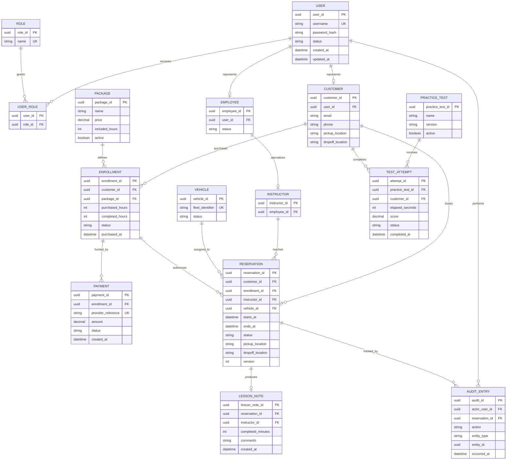

# DriverPass Data and API Design

## Design Status

This document is a proposed implementation design derived from the DriverPass requirements and UML portfolio models. It demonstrates how the analysis could be translated into relational data and service contracts. It is not a claim that the database, API, integrations, or deployment currently exist.

## Relational Data Model

## Data-Integrity Rules

1. Usernames, fleet identifiers, and external payment references must be unique.
2. Package records should be deactivated rather than deleted when historical records reference them.
3. Reservations should use explicit lifecycle states such as pending, confirmed, completed, canceled, and no-show.
4. A confirmed reservation must be exactly two hours unless a later approved business rule introduces alternatives.
5. Customer, instructor, and vehicle overlaps must be prevented at the persistence boundary, not only in the interface.
6. Reservation creation, resource assignment, and audit recording should succeed or fail as one transaction.
7. Package-hour consumption must be idempotent so retries cannot deduct time twice.
8. Payment records store provider references and outcomes, not full card or bank credentials.
9. Audit history is append-only for normal application roles.
10. Optimistic versioning or an equivalent concurrency control should protect reservation modifications from lost updates.

## Proposed Service Boundaries

| Service | Responsibilities |
|---|---|
| Identity and Access | Authentication, password reset, sessions, account status, roles, and authorization |
| Customer | Customer profile and contact/location information |
| Catalog | Training packages, course access, and package activation status |
| Payment | Provider integration, idempotency, reconciliation, and safe payment status |
| Scheduling | Eligibility, availability, reservation lifecycle, assignments, and conflict prevention |
| Training | Course content, practice tests, attempts, lesson notes, and progress |
| Reporting | Authorized report generation and safe export |
| Audit | Append-only records for security-sensitive and business-critical changes |
| Integration | Approved DMV updates and notification-provider boundaries |

These are logical responsibilities, not a recommendation to begin with separately deployed microservices. A modular monolith could keep these boundaries while reducing operational complexity for an initial release.

## Proposed API Surface

| Method and path | Purpose | Typical authorized roles |
|---|---|---|
| `POST /sessions` | Authenticate and create a protected session | All users |
| `DELETE /sessions/current` | End the current session | All authenticated users |
| `POST /password-resets` | Begin a safe password-reset flow | Public or authenticated user |
| `GET /packages` | List packages available to the caller | Customer, Secretary, Owner |
| `PATCH /packages/{packageId}` | Change package availability | Owner |
| `POST /enrollments` | Begin a package purchase | Customer, Secretary |
| `POST /payment-attempts` | Initiate or reconcile a provider transaction | Customer, Secretary, system integration |
| `GET /availability` | Find eligible two-hour lesson slots | Customer, Secretary |
| `POST /reservations` | Create and assign a lesson reservation | Customer, Secretary |
| `PATCH /reservations/{reservationId}` | Modify an eligible reservation | Customer, Secretary |
| `POST /reservations/{reservationId}/cancellation` | Cancel without erasing history | Customer, Secretary |
| `POST /reservations/{reservationId}/lesson-note` | Record completed time and instructor comments | Assigned Instructor |
| `GET /customers/{customerId}/progress` | View package, lesson, and test progress | Customer owner of record, authorized staff |
| `POST /practice-tests/{testId}/attempts` | Submit a practice-test attempt | Eligible Customer |
| `GET /reports/{reportType}` | Generate an authorized report | Owner and explicitly authorized roles |
| `PATCH /accounts/{userId}/status` | Block, deactivate, or restore account access | IT Officer |

## Reservation Transaction

A scheduling request should be processed as one protected operation:

1. Authorize the actor for the customer and requested action.
2. Validate required data, time boundaries, and the two-hour rule.
3. Verify enrollment status and eligible remaining hours.
4. Check customer, instructor, and vehicle availability for the complete interval.
5. Acquire the database protection needed to prevent concurrent overlaps.
6. Create the reservation and assignments.
7. Append the audit entry.
8. Commit once; otherwise roll back all changes.
9. Send notifications only after commit, using a retryable mechanism that cannot duplicate the reservation.

The interface may perform early checks for usability, but the backend and database remain authoritative.

## API Error Contract

Errors should use stable machine-readable codes plus safe user-facing messages. A response should include a correlation identifier for support without exposing stack traces, credentials, another customer's schedule, or payment details.

Representative categories include:

- `VALIDATION_FAILED`
- `AUTHENTICATION_REQUIRED`
- `NOT_AUTHORIZED`
- `RESOURCE_NOT_FOUND`
- `PACKAGE_HOURS_INSUFFICIENT`
- `SCHEDULE_CONFLICT`
- `PAYMENT_NOT_CONFIRMED`
- `CONCURRENT_MODIFICATION`
- `INTEGRATION_UNAVAILABLE`

## Security and Privacy Boundaries

- Enforce authorization in the backend for every protected operation.
- Use secure password hashing and appropriately protected session tokens.
- Require encrypted transport for all external communication.
- Keep payment credentials within the selected payment provider's controlled flow.
- Validate all provider callbacks and DMV updates cryptographically where supported.
- Minimize personal data in logs and exports.
- Protect report downloads against unauthorized reuse and formula injection.
- Rate-limit authentication, password-reset, availability, and integration endpoints according to risk.
- Define retention and deletion rules before production implementation.

## Open Architecture Decisions

Before implementation is finalized, stakeholders should decide:

- Cancellation, refund, rescheduling, and no-show rules
- When package hours become reserved and when they are consumed
- Whether instructors or vehicles may be selected manually or assigned automatically
- Time zone, operating hours, holidays, and daylight-saving behavior
- Payment-provider and DMV-integration contracts
- Notification channels and consent requirements
- Report formats and maximum export sizes
- Accessibility, browser-support, availability, and recovery targets
- Data-retention and deletion obligations

