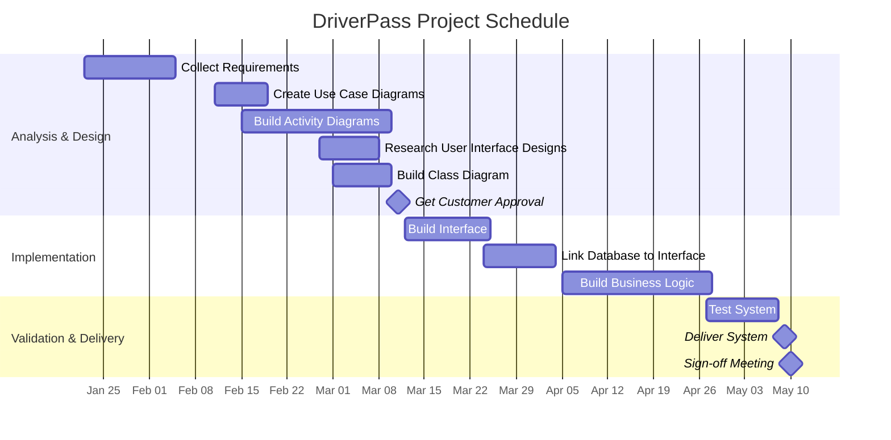

# DriverPass Project Schedule

This schedule is based on the DriverPass stakeholder interview and the final CS 255 business-requirements work.

## Dependencies and Rationale

| Task | Start | End | Dependency / Rationale |
|---|---|---|---|
| Collect Requirements | Jan 22 | Feb 4 | Project start |
| Create Use Case Diagrams | Feb 11 | Feb 18 | Requirements |
| Build Activity Diagrams for Each Use Case | Feb 15 | Mar 9 | Use cases |
| Research User Interface Designs | Feb 27 | Mar 7 | Independent design research |
| Build Class Diagram | Mar 1 | Mar 9 | Requirements and staff availability |
| Get Customer Approval | Mar 10 | Mar 11 | Design models and UI research |
| Build Interface | Mar 12 | Mar 24 | Customer approval |
| Link DB to Interface | Mar 24 | Apr 3 | Interface |
| Build Business Logic | Apr 5 | Apr 27 | Database connection |
| Test System | Apr 27 | May 7 | Integrated system |
| Deliver System | May 8 | May 9 | Testing |
| Sign-off Meeting | May 9 | May 10 | Delivery |

## Planning Notes

Several tasks overlap because they can proceed concurrently. User-interface research does not depend on the use-case work, and the class diagram begins when the assigned resource becomes available. Implementation begins after customer approval, followed by database integration, business logic, testing, delivery, and final sign-off.

The schedule demonstrates dependency analysis, sequencing, concurrency, milestone planning, and the relationship between systems-design work and implementation.