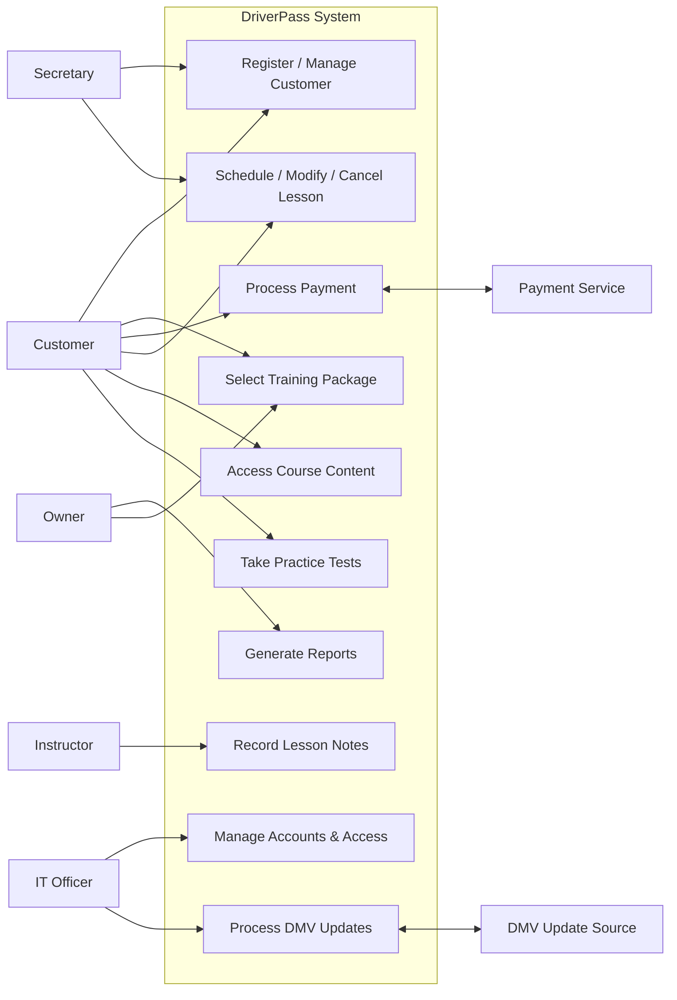
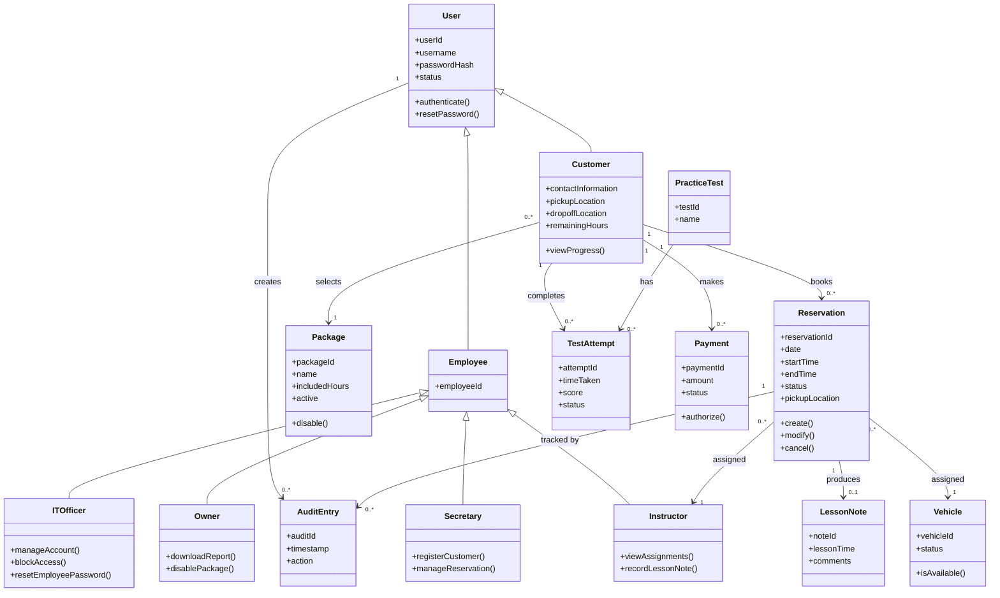
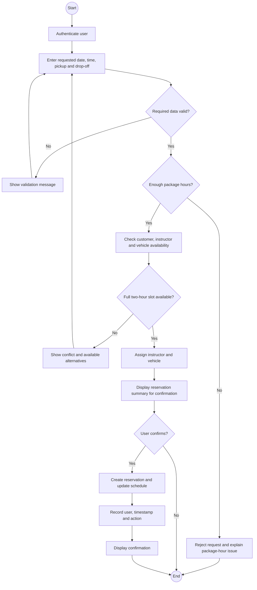
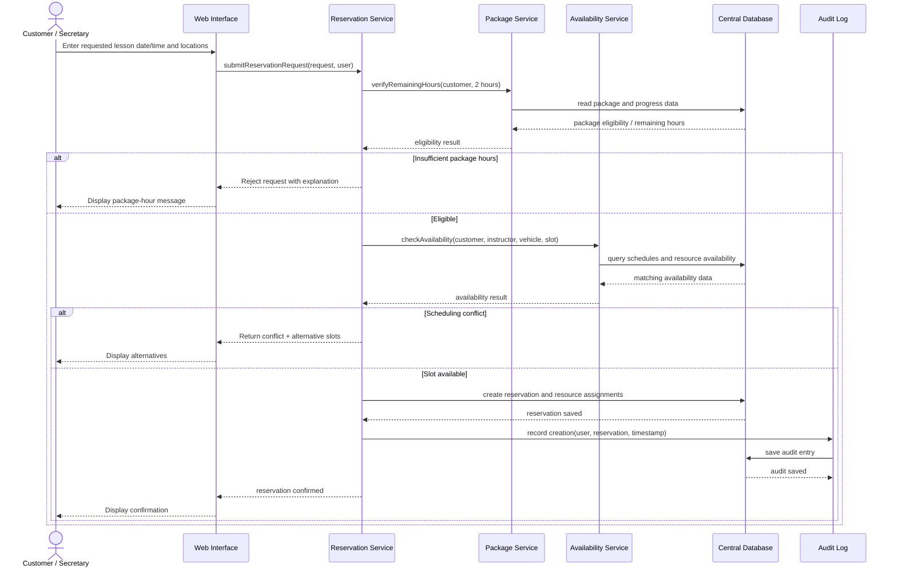

# DriverPass UML Portfolio Models

> **Portfolio note:** The diagrams on this page are portfolio reconstructions derived from my DriverPass requirements and modeling analysis. They are not presented as screenshots of the original course templates or as production-ready system specifications. Their purpose is to show how I translate requirements into structural and behavioral models.

## Modeling Focus

DriverPass has several important workflows, but lesson scheduling is one of the strongest examples because it connects customers, employees, packages, instructors, vehicles, reservations, validation rules, and audit history.

The models below focus on that workflow while also showing the larger object structure needed to support it.

## Use-Case Overview

This is a high-level functional overview rather than formal UML use-case notation.

## Structural Model: Core Class Diagram

The class model emphasizes shared user behavior, employee specialization, scheduling resources, package eligibility, testing, payments, and audit history.

## Behavioral Model: Schedule Driving Lesson Activity

This activity model follows the reservation rules identified in the requirements: the customer must have enough package hours, the customer/instructor/vehicle must all be available for the full two-hour session, and a successful change must create an audit record.

## Behavioral Model: Schedule Driving Lesson Sequence

The sequence diagram shows the same reservation scenario from an interaction perspective. It makes the order of validation, data access, conflict checking, persistence, and audit logging explicit.

## Design Decisions Represented

- **Centralized validation:** reservation rules are checked before data is committed.
- **No double-booking:** customer, instructor, and vehicle availability must all be valid for the full two-hour lesson.
- **Role-aware workflows:** both customers and secretaries can initiate reservation activity, while other roles have narrower responsibilities.
- **Auditability:** successful reservation changes are associated with the user and timestamp that produced them.
- **Separation of responsibilities:** package eligibility, availability checking, reservation persistence, and auditing are represented as distinct responsibilities.
- **Object-oriented structure:** shared user behavior is inherited while specialized employee roles keep role-specific operations separate.

## Traceability to Requirements

These diagrams are based on requirements that call for:

- browser-based access for customers and employees;
- role-based permissions;
- customer and secretary reservation management;
- two-hour driving lessons;
- instructor and vehicle assignment;
- prevention of overlapping reservations;
- tracking of remaining package hours;
- practice-test and lesson-progress records;
- downloadable reporting;
- and audit history for reservation creation, modification, and cancellation.

The goal of these models is to provide a clear bridge from stakeholder requirements to an implementable software structure without implying that the modeled system has already been built.
